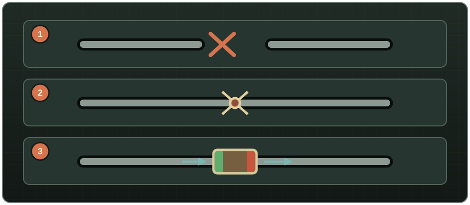

# Core concepts

## One connected component, one shared supply

A network is every pipe and vessel reachable without crossing a closed boundary. Containers in that component share a fluid summary; fixtures and generators draw from it. A pipe must occupy an object's own tile for that object to participate.

```text
source/storage ── pipe ── pump ── consumer
                       │
                       └── branch ── consumer
```

Incompatible liquids do not mix: transfers that would combine petrol with water, or any other incompatible pair, are rejected. Clean and tainted water are compatible, but combining them turns the resulting water tainted. Dedicated networks are still recommended so every consumer receives the intended fluid.

## Boundaries

| Element | Open or ordinary state | Boundary state |
|---|---|---|
| Physical gap | Always separate | No connection exists |
| Shut-off Valve | Open: one network | Closed: two networks; no fluid, pressure, or contamination crosses |
| Fluid Router | Always separates IN and OUT | Transfers one way, optionally with a pressure ceiling |
| Router with vessel/purifier | Hard boundary | Exchange occurs only through that object |

Vertical pipes connect floors through north or west wall edges. Pressure determines whether a reachable consumer can actually draw: elevation helps, distance and shared demand cost pressure, pumps add it, and routers only reduce it.

{ .wp-diagram }

- **1** Physical gap.
- **2** Closed shut-off valve.
- **3** One-way Fluid Router, green IN to red OUT.
