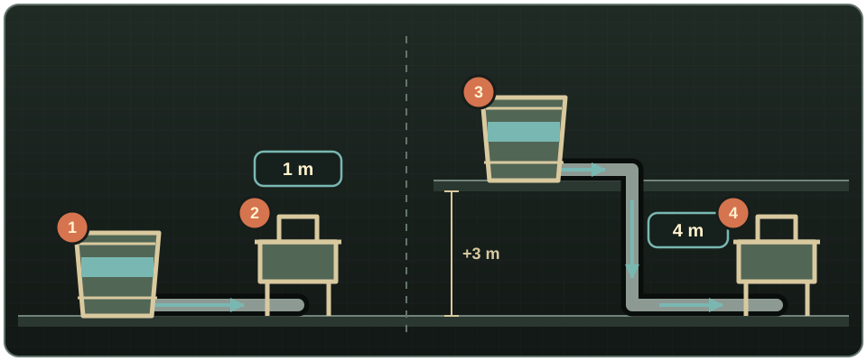
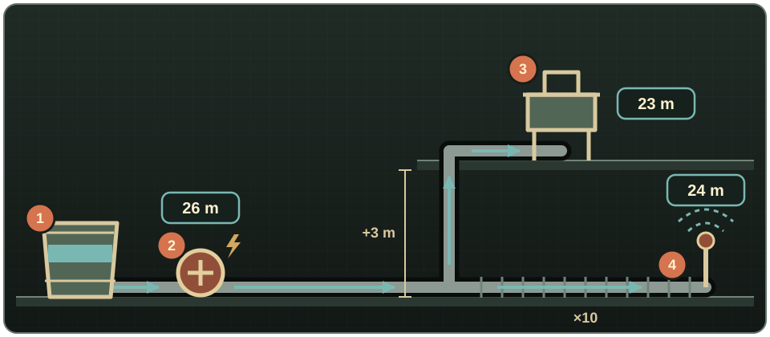
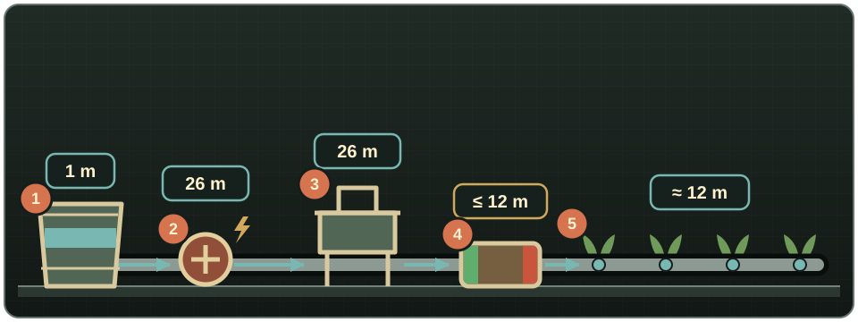

# Getting started

Water Pipes is a **Project Zomboid Build 42.15+** mod. Its parts are built from **Build menu → Piping**. Keep a usable Pipe Wrench in your inventory: it is required for most construction and plumbing actions but is not consumed.

## Small-base starter network

This first network needs one Pipe Wrench, one Metal Pipe or fired Clay Pipe Segment for each pipe tile, one water container, and one supported fixture such as a sink.

1. Put a barrel, rain collector, amphora, or other fluid container where the network will store water.
2. Build a **Fluid Pipe** on the container's own tile.
3. Extend the run to the fixture. Pipes connect automatically into straights, corners, junctions, and crosses.
4. Build the final pipe on the fixture's own tile; adjacency is not enough.
5. With the Pipe Wrench in your inventory, right-click the fixture and choose **Plumb**.
6. Right-click any pipe and choose **Show pipe network**. Pipes appear red, sources and storage green, consumers blue, and pressure-regulated routers amber.
7. Test the fixture. If it gives no water, check that the container holds water and stands on the fixture's floor or higher; otherwise read the installations below.

<!-- SCREENSHOT: 01-getting-started-materials.png — Pipe Wrench, pipes and a container ready for the starter build. -->
<!-- SCREENSHOT: 02-getting-started-small-network.png — Complete container-to-sink starter network with the overlay visible. -->

## Three starter installations

Pressure is measured in metres of water column (m). With default settings, a fixture receives:

- **What the storage builds.** Every container holding water gives 1 m on its own floor, plus 3 m for each floor it stands above the fixture. Containers do not add up: the highest one sets the pressure.
- **Plus 25 m per powered pump** in the network. A pump lifts every container in it, and pumps in series add up.
- **Capped by a router**, if one stands in between. A router can lower pressure, never raise it.

Distance only costs pressure where irrigation draws through the pipe: about 0.2 m per tile for each sprinkler downstream, about 0.02 m per tile for each drip emitter. Sinks, showers, toilets, and other fixtures lose nothing over distance. A fixture works with any pressure above zero; a sprinkler needs 20 m, and a drip emitter bursts above 15 m.

### 1. Storage only

{ .wp-diagram }

- **1** Barrel on the same floor as **2**, a sink: 1 m base = **1 m**. Low, but enough for a fixture.
- **3** Barrel one floor up, piped down to **4**, a sink on the ground floor: 1 m + 3 m = **4 m**.

The storage itself is the pressure source: raising it is the cheapest way to gain pressure. The reverse does not work: a sink one floor above its only barrel gets 1 − 3 = −2 m and no water. Raise the barrel or add a pump.

### 2. Storage and a water pump

{ .wp-diagram }

- **1** Barrel on the ground floor: 1 m.
- **2** Powered Water Pump: 1 + 25 = **26 m** for the whole network.
- **3** Sink one floor up: 26 − 3 = about **23 m** (the sprinkler's flow costs a little on the shared stretch).
- **4** Sprinkler ten tiles of pipe from the barrel: 26 − 10 × 0.2 = **24 m**, above the 20 m it needs. Without the pump it would get 1 − 2 = −1 m and stay dry.

The barrel is still required: a pump boosts and moves water but stores none.

### 3. Pump with a router-protected drip zone

{ .wp-diagram }

- **1–2** Barrel and powered pump as above: **26 m**.
- **3** Sink on the main line: **26 m**.
- **4** Fluid Router, green IN towards the pump, red OUT towards the crops, with **Set pressure limit** at 12 m. Water and pressure cross only from IN to OUT.
- **5** Drip emitters behind the router: about **12 m**, safely under the 15 m that bursts them. Wired straight to the pump line they would get 26 m and burst.

A router needs no power and never adds pressure: with the pump off, the drips get the barrel's 1 m. More in [Routers and valves](routers-and-valves.md) and [Irrigation](irrigation.md).

!!! warning
    A pump supplies or moves water but does not store it. Give the network at least one container, and never join petrol and water in the same network.

## Find what you need

| I want to… | Read… |
|---|---|
| See every construction recipe | [Pipe networks](pipe-networks.md), [Pumps and pressure](pumps-and-pressure.md), [Routers and valves](routers-and-valves.md), [Purification](purification.md), and [Irrigation](irrigation.md) |
| Compare every buildable component | [Component reference](component-reference.md) |
| Follow complete example installations | [Practical examples](practical-examples.md) |
| Draw from a well, river, town mains, or hydrant | [Sources and storage](sources-and-storage.md) |
| Connect a sink, shower, toilet, or washing machine | [Fixtures and plumbing](fixtures-and-plumbing.md) |
| Automatically pipe an existing house | [Plumbing a building](building-plumbing.md) |
| Move petrol and refuel a generator | [Fuel transport](fuel-transport.md) |
| Change difficulty or simulation values | [Sandbox settings](sandbox-settings.md) |
| Diagnose something that does not work | [Troubleshooting](troubleshooting.md) and the [FAQ](faq.md) |

## Where to go next

- Learn placement and dismantling in [Pipe networks](pipe-networks.md).
- Add natural sources and storage in [Sources and storage](sources-and-storage.md).
- Solve long or uphill runs in [Pumps and pressure](pumps-and-pressure.md).
- Connect a whole building in [Plumbing a building](building-plumbing.md).
