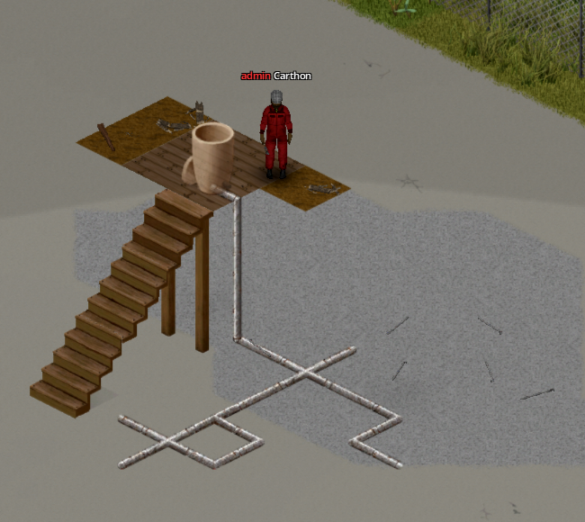

# Pipe networks

## Pipe recipes

| Build entry | Requirements | Consumed |
|---|---|---|
| Fluid Pipe | Pipe Wrench | 1 Iron Pipe **or** 1 fired Clay Pipe Segment |
| Vertical Fluid Pipe | Pipe Wrench | 1 Iron Pipe **or** 1 fired Clay Pipe Segment |
| Concealed Fluid Pipe | Pipe Wrench | 1 pipe plus 1 full supported bucket of prepared clay cement or concrete |
| Concealed Vertical Fluid Pipe | Pipe Wrench | 1 pipe plus 1 full supported bucket of prepared clay cement or concrete |

The wrench is kept. Ordinary builds have no skill requirement. An Iron Pipe can also be forged at a Primitive Forge from Charcoal, an Iron Bar Half, and an Iron Bar Quarter, using a hammer, tongs or pliers, and a punch (see the [reference](component-reference.md#related-recipe)).

!!! note "Cement consumption"
    Each concealed pipe consumes one complete prepared bucket, so one bucket builds one pipe tile. The accepted variants are Clay Cement and Concrete in standard or carved buckets.

## Placement and connection

Floor pipes auto-tile into ends, straights, corners, T-junctions, and crosses. Only one floor pipe can occupy a tile. Rotate fixed-axis devices with **R** before placement. Vertical pipes mount on north or west walls and link floor pipes across levels; a tile may hold a floor pipe and both wall-edge risers.

Concealed variants have the same network behavior but become invisible after construction. Use **Show pipe network** on any visible or concealed pipe to reveal the connected network temporarily; use **Hide pipe network** to clear it early.

!!! tip "Finding a concealed network"
    If no visible pipe remains to open the network view, select :material-hammer-screwdriver: **Disassemble** from the left-hand action bar. Its selection cursor makes concealed pipes targetable, helping you locate the run. Cancel the action once you have found it unless you actually want to remove that segment.

{ .wp-screenshot loading=lazy }

## Dismantling and recovery

Use the game's :material-hammer-screwdriver: **Disassemble** action rather than the moveable-object tool.

- A pipe you built from an Iron Pipe has a 90% chance to return it.
- A clay pipe returns nothing: the fired segment is spent when laid.
- Concealed pipe revealed by **Plumb this building** returns nothing because that inspection is priced per fixture.
- Destroying a pipe with a sledgehammer, fire, or damage returns nothing.
- A valve or gauge removed with its underlying pipe returns each of its ingredients independently at 90%.

Removing the pipe from a plumbed fixture or generator's own tile disconnects it automatically.
