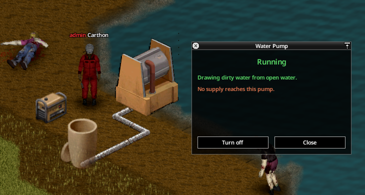
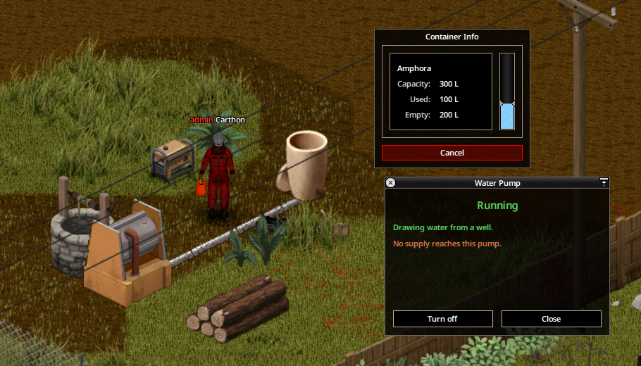
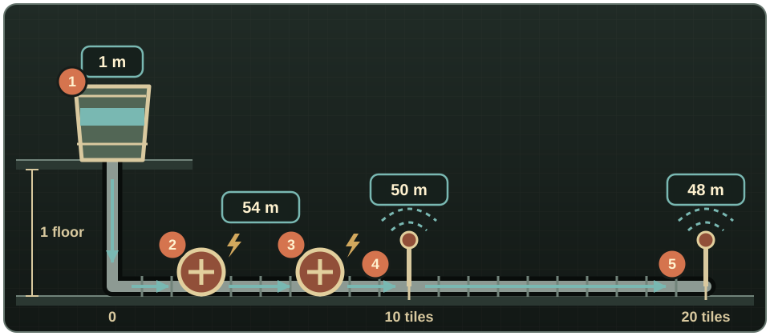

# Pumps and pressure

## Building a pump

A **Water Pump** requires Electricity 3, Metal Welding 2, a Pipe Wrench, 2 Blow Torch uses, 1 Welding Rod use, 2 Metal Pipes, 4 Sheet Metal, 2 Electronics Scrap, and 1 Wire. Construction awards 30 Electricity XP and 20 Metal Welding XP. Rotate before placement to choose its north–south or east–west axis.

A pump needs electrical power and its manual switch must be on. On an existing supply line it acts as a booster; beside a well or open water it also draws water into the network. Put it low: the default suction limit is 7 m (about two floors), while it can add 25 m of output pressure. Powered pumps in series add their pressure.

{ .wp-screenshot loading=lazy }
{ .wp-screenshot loading=lazy }

## How pressure is calculated

Pressure is measured in metres of water column (m head). In the default **Realistic** model:

- a container starts with 1 m of pressure;
- each floor the source sits above the consumer adds 3 m;
- pipe distance spends pressure according to flow and shared downstream demand;
- each powered pump adds 25 m;
- routers can cap, but never increase, downstream pressure.

The **Simple** model counts height but ignores distance loss. **Off** restores gravity-only reachability. A low-pressure transfer can still run below full speed; flow scales down until the consumer's minimum is no longer met.

{ .wp-diagram }

- **1** Barrel one floor above the line: 1 m + 1 floor × 3 m = 4 m.
- **2–3** Two powered pumps. Each adds 25 m to the whole network, wherever it stands: 4 m + 2 × 25 m = **54 m**.
- **4** Sprinkler 10 tiles out. Both sprinklers draw through that stretch: 54 m − 10 tiles × 2 × 0.2 m = **50 m**.
- **5** Sprinkler 20 tiles out. From tile 10 to 20 only its own flow passes: 50 m − 10 tiles × 0.2 m = **48 m**.

Shared demand is what makes distance expensive: every irrigation consumer downstream adds its flow to the loss on each tile it shares.

## Diagnosis

Use **Check pump** to distinguish switched off, no power, no source, and pressure-only operation. Build a **Pressure Gauge** over an existing plain pipe with 1 Metal Pipe and 1 Electronics Scrap; right-click it to see the local value and whether a sprinkler can run there.

For a starved branch, shorten it, reduce simultaneous demand, divide consumers into router-controlled zones, raise the source, or add a powered pump. Check [Sandbox settings](sandbox-settings.md) because every default above is configurable.
