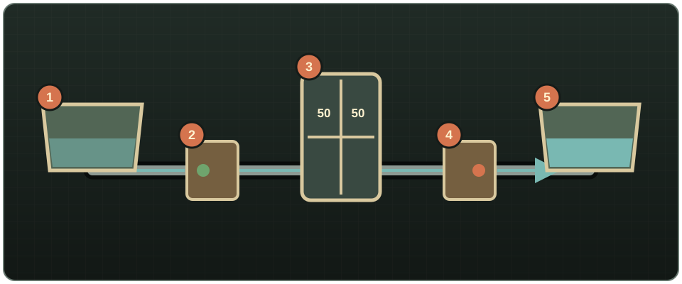

# Purification

## Construction

The **Water Purifier (Electric)** requires Electricity 4, Metal Welding 3, a Pipe Wrench, 3 Blow Torch uses, 2 Welding Rod uses, 3 Metal Pipes, 2 Sheet Metal, 1 Electronics Scrap, 1 Wire, 1 Lighter Battery, 1 charcoal item, and 2 Ripped Sheets. Building it awards 40 Electricity XP and 30 Metal Welding XP.

First build and orient a Fluid Router: green is tainted-water **IN**, red is clean-water **OUT**. The purifier occupies 2×2 tiles; place its top/back corner on the router tile and leave the floor above that anchor clear. It will not place over another purifier or without the router.

{ .wp-diagram }

1. Tainted storage. 2. Green router input. 3. Powered purifier and filter. 4. Red router output. 5. Clean storage.

<!-- SCREENSHOT: 13-purifier-placement.png — Build ghost showing the purifier anchor over the router and its 2×2 footprint. -->

## Operation and filter

While powered, it draws tainted water at up to 20 units/min and converts up to 10 units/min. Its internal input and output buffers each hold 50 units. Clean water and mixed liquids are not filtered. External clean-side storage is optional, but recommended: without it, processing pauses when the 50-unit output buffer fills.

The filter starts at 100%. At the default wear rate it cleans about 5,000 units before clogging. Right-click **Repair filter** with 1 charcoal item and 2 Ripped Sheets; repair returns it to 100%. **Open Purifier** reports power, input, output, rate, and filter condition. Ambient machine sound can be disabled under **Options → Mods → Water Pipes**.

By default the clean side receives 60% of incoming pressure: 25 m becomes 15 m, enough for taps and drip irrigation but below a sprinkler's 20 m requirement. Add a pump after the purifier or change the sandbox transfer percentage when necessary.

## Dismantling

Use a fueled Blow Torch and Welding Mask. Each return is rolled separately: 1 Sheet Metal and 2 Metal Pipes at 80%, plus 1 Electronics Scrap and 1 Wire at 60%. Battery, charcoal, and sheets are not returned; destruction returns nothing.

<!-- SCREENSHOT: 15-purifier-status-window.png — Purifier window while actively filtering. -->
