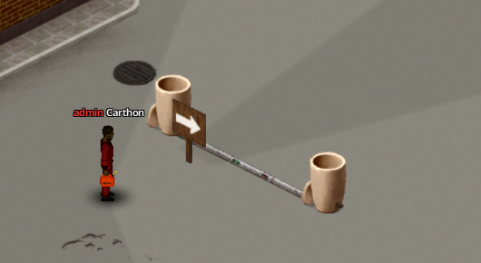
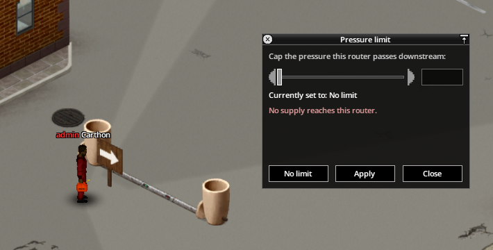
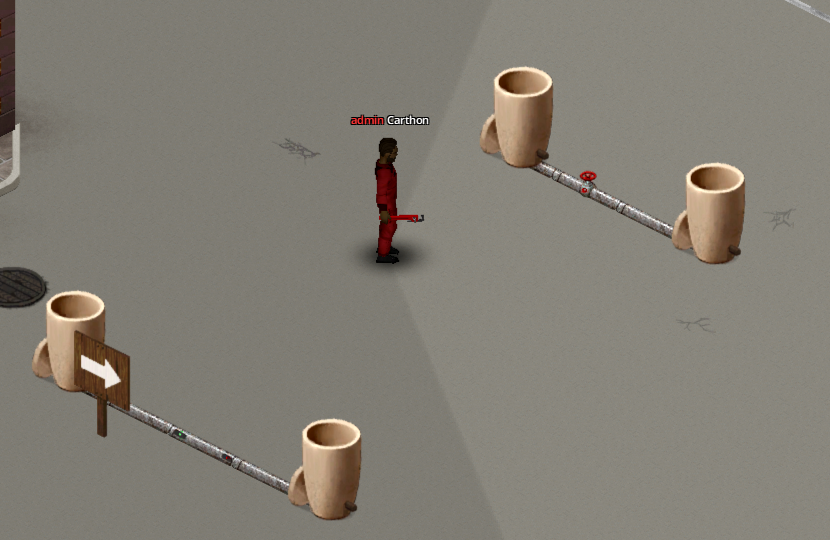
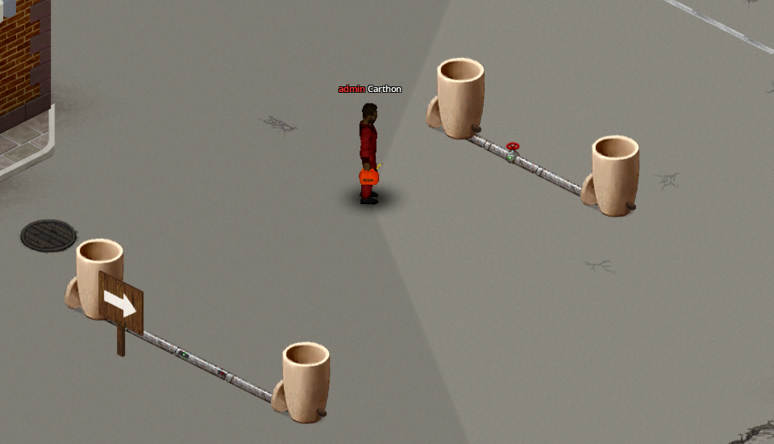

# Routers, valves, and gauges

| Device | Recipe | Placement |
|---|---|---|
| Fluid Router | Pipe Wrench, 2 Metal Pipes, 1 Sheet Metal | Replaces a floor-pipe tile; rotate with **R** |
| Shut-off Valve | Pipe Wrench, 1 Metal Pipe, 1 half iron bar | Fits over an existing plain floor pipe |
| Pressure Gauge | Pipe Wrench, 1 Metal Pipe, 1 Electronics Scrap | Fits over an existing pipe without a valve |

## Fluid Router

The green band is **IN** and the red band is **OUT**. Fluid and pressure cross only in that direction. A bare router transfers up to 30 units per in-game minute and can reduce downstream pressure to a chosen ceiling; it never creates pressure. Several routers sharing one source take turns rather than multiplying the source's output.

Right-click the router and choose **Set pressure limit**. The dialog reports incoming and outgoing pressure. Use no limit for one-way flow only, below 15 m to protect default drip emitters, or at least 20 m when a downstream sprinkler must run. A container or purifier on the router tile creates a hard boundary whose two sides exchange only through that object.

{ .wp-screenshot loading=lazy }
{ .wp-screenshot loading=lazy }

## Shut-off Valve

A valve is built open and does not alter the network until closed. Closed, its tile stops conducting: both sides cease sharing liquid, pressure, and contamination. Use valves to isolate maintenance areas, separate water from petrol, or stop contamination before changing a layout. A valve cannot share a tile with a gauge, router, pump, drip emitter, or sprinkler.

{ .wp-screenshot loading=lazy }
{ .wp-screenshot loading=lazy }

