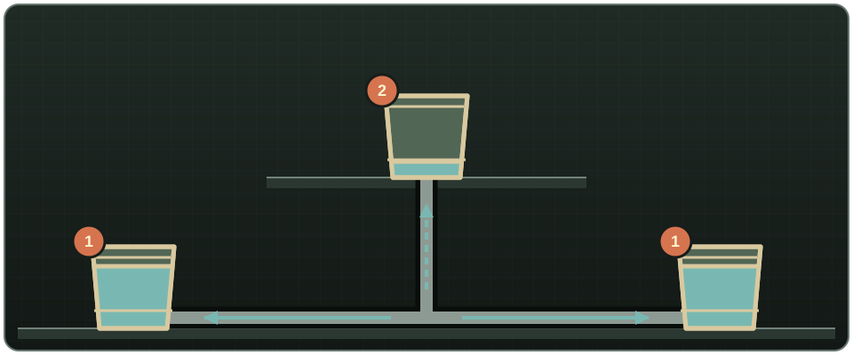
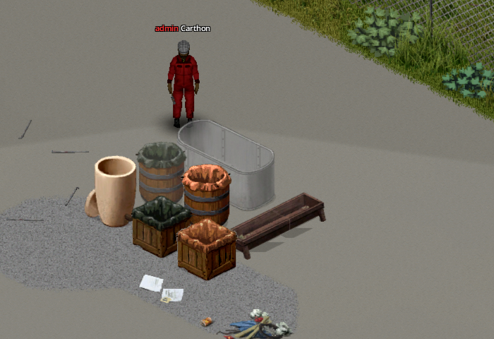
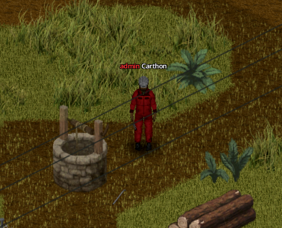
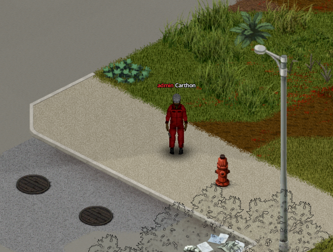

# Sources and storage

## What joins a network

A finite world fluid container joins when a floor pipe occupies its **own tile**. This covers the base game's rain collectors (barrel or crate) and amphorae, plus modded containers that expose a normal fluid capacity, such as [Useful Barrels' barrels](glossary.md#barrel). Washing machines and other fixtures are treated as consumers, not storage. Objects with a capacity of 9,999 or more are excluded from ordinary finite-container balancing; they only act as sources when specific source logic recognizes them.

Network storage settles every two in-game minutes: lower floors fill first, while containers on the same floor equalize by capacity. A pump is not storage; always include a vessel where incoming water can remain.

{ .wp-diagram }

- **1** Lower-floor containers: they fill and level first.
- **2** Upper-floor container: it takes the overflow once the ones below are full.

| Source | Fluid | Default rate or reserve | Setup |
|---|---|---:|---|
| Rain collector, amphora, [Useful Barrels barrel](glossary.md#barrel) | Existing contents | Container capacity | Put a floor pipe on its tile; open a Useful Barrels barrel first, since a closed one holds no liquid |
| Well | Clean water | Pump: 20 L/min | Put a powered pump directly north, south, east or west of it (not diagonally); decorative wells from maps or mods don't count |
| River or lake | Tainted water | Pump: 20 L/min, unlimited source | Put a powered pump on or directly beside open water (not diagonally); enabled by sandbox setting |
| Town mains | Clean water | 60 L/min at 25 m head | Plumb an indoor fixture before the water shuts off |
| Fire hydrant | Clean water | 60 L/min; 1,000 L reserve after shutoff | Put a pipe on its tile and open it with a Pipe Wrench |

{ .wp-screenshot loading=lazy }
{ .wp-screenshot loading=lazy }
{ .wp-screenshot loading=lazy }

## Fluid compatibility and water quality

Incompatible liquids never combine. A transfer that would mix petrol with water, or another incompatible liquid pair, is rejected; it does not contaminate either vessel. Keep separate pipe networks because fixtures and generators still require the correct fluid.

Clean and tainted water are the exception: they are compatible, and combining them makes the resulting water tainted. With realistic purification enabled, only the **Water Purifier (Electric)** restores clean water.
