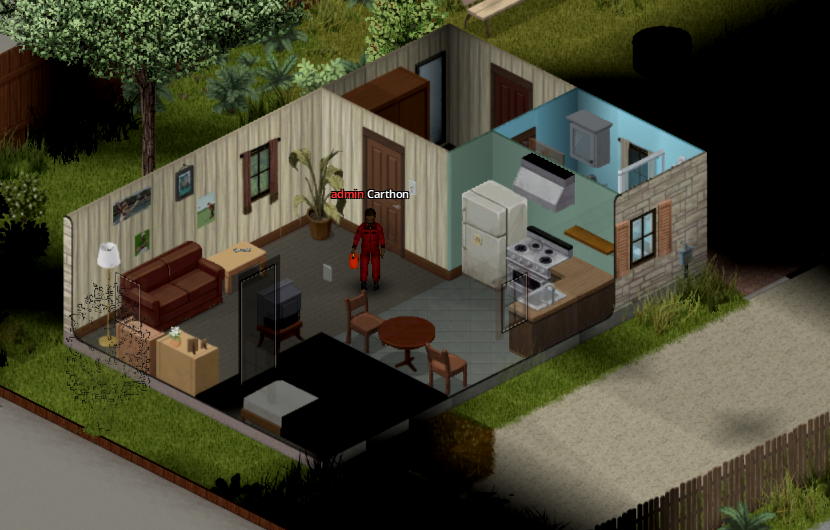
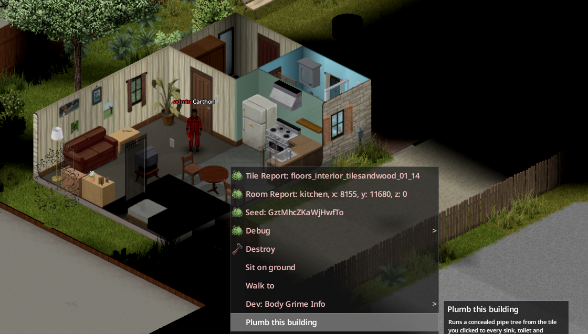
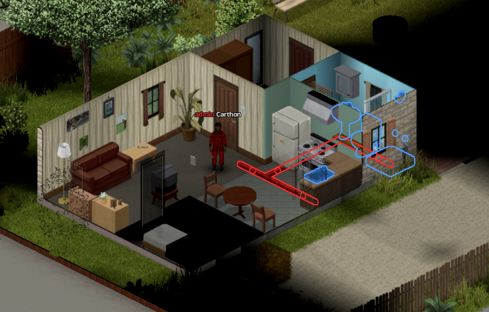

# Inspeccionar la fontanería de un edificio

Las casas y edificios que ya vienen en el mapa se consideran con la fontanería ya instalada: en la vida real tendrían tuberías dentro de suelos y paredes. Para no tener que crear esas tuberías en todos los edificios del mapa, Water Pipes solo las crea cuando tú lo pides con la opción **[Fontanear el edificio](glossary.md#fontanear-el-edificio)**. Pese a su nombre, lo que hace en la práctica es **inspeccionar el edificio y sacar a la luz la fontanería que ya tenía**. No sirve para poner tuberías automáticamente en algo que hayas construido tú.

Al inspeccionarlo, el mod crea [tuberías ocultas](glossary.md#tuberia-oculta) desde la casilla en la que hiciste clic hasta cada [aparato](glossary.md#aparato) sin conectar que pueda alcanzar dentro del mismo edificio. Las tuberías se ramifican como las de una casa real, sin formar circuitos cerrados. Aprovecha las tuberías compatibles que ya hubiera, solo cambia de planta por paredes norte u oeste (donde puede ir una tubería vertical) y nunca coloca una tubería oculta encima de otra.

!!! warning "Solo edificios del mapa"
    **Fontanear el edificio no pone tuberías en los edificios que construyen los jugadores.** En esos tienes que tender a mano las tuberías de suelo, ocultas y verticales, y después instalar cada aparato de la forma habitual.

## Paso a paso

1. Entra en el edificio con una Llave para tubos utilizable.
2. Lleva los Tubos metálicos necesarios: por defecto, uno por cada aparato que se vaya a conectar, sin importar lo larga que sea la tubería.
3. Haz [clic derecho](glossary.md#clic-derecho) en una casilla con suelo y elige **Fontanear el edificio**.
4. Lee la descripción, que indica el coste, y empieza la acción. Tarda un rato; los aparatos más cercanos se conectan primero.
5. Cuando termine, conecta la tubería que ha salido a un [depósito](glossary.md#deposito) o a una [fuente](glossary.md#fuente) y compruébala con **Mostrar red de tuberías**.

Una sola inspección puede crear como máximo 200 casillas de tubería nueva y revisar hasta 8000 casillas del edificio. Si se queda a medias, repítela desde otro punto. Los tubos se cobran al empezar, y se te devuelven los de los aparatos a los que no consigue llegar. Si la acción se interrumpe, las tuberías ya creadas se quedan. Las tuberías creadas así no devuelven material al desmontarlas.

{ .wp-screenshot loading=lazy }

{ .wp-screenshot loading=lazy }

{ .wp-screenshot loading=lazy }

## Mensajes del juego

| Mensaje o motivo | Qué significa y qué hacer |
|---|---|
| No estás dentro de un edificio | La casilla elegida no pertenece a un edificio del mapa. Haz clic en una casilla con suelo dentro del edificio |
| Aquí no hay nada que fontanear | No se ha encontrado ningún aparato compatible sin conectar |
| Este edificio ya está fontaneado | Todos los aparatos que ha encontrado ya están conectados |
| Edificio demasiado grande | Solo se ha revisado la parte más cercana a ti; repite desde otra zona |
| No hay ruta desde aquí | Las paredes o una red que ya existe impiden llegar sin peligro |
| No hay pared para llegar a su planta | Hace falta una pared norte u oeste para subir o bajar; prueba desde otro punto |
| Conectarlo cerraría un anillo | Se ha saltado a propósito para no crear un circuito cerrado de tuberías |
| Supera el límite de distancia | Se han alcanzado las 200 casillas nuevas; repite desde otro punto |
| El servidor ha detenido el trabajo | En [multijugador](glossary.md#multijugador), el servidor ha rechazado la petición porque estaba desfasada, no era válida o faltaban tubos |

En multijugador, la inspección la hace y la comprueba el servidor. Tu juego espera su permiso antes de conectar cada aparato, y al terminar se te devuelve el coste de las conexiones que no se hayan podido completar.
