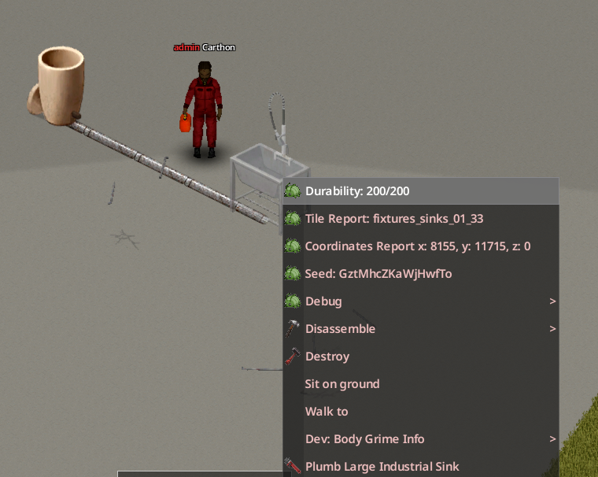

# Aparatos y fontanería

## Objetos compatibles

Water Pipes reconoce objetos que el juego marca como aparatos fontaneables, objetos que declaran una fuente de agua externa y las tres clases de lavadora de Build 42. En la práctica cubre:

| Grupo | Ejemplos | Papel en la red |
|---|---|---|
| Grifos y lavabos | Fregaderos y lavabos | Beber, lavar, llenar y transferir desde la red |
| Aparatos de baño | Duchas, bañeras e inodoros | Consumidor de agua |
| Electrodomésticos | Lavadora, lavadora-secadora y torre de lavado | Alimenta el depósito interno del aparato |
| Aparatos de otros mods | Por ejemplo, Take A Bath And Shower | Consumidor externo si el mod expone las propiedades esperadas |

La detección se basa en capacidades y no en una lista fija de sprites, por lo que un aparato de otro mod puede funcionar sin estar nombrado individualmente.

## Conectar un aparato

1. Construye una tubería de suelo en la **misma casilla** del aparato.
2. Lleva una Llave para tubos utilizable.
3. Haz clic derecho y elige **Fontanear**.
4. Prueba la acción normal y usa **Mostrar red de tuberías** si no recibe suministro.
5. Elige **Desinstalar** para restaurar exactamente el estado previo del fluido y del agua municipal.

Quitar la tubería de su casilla también lo desconecta; una rotura más lejos solo corta el suministro. Mientras siga el agua municipal y esté habilitada su opción de sandbox, un aparato interior fontaneado puede alimentar la red con agua limpia y presión de acometida.

!!! note "Interfaz de la lavadora"
    Una lavadora conectada sigue funcionando desde su ventana de inventario. Build 42 puede ocultar la opción redundante **Encender** del menú de la casilla cuando su depósito contiene agua.

{ .wp-screenshot loading=lazy }
<!-- SCREENSHOT: 20-supported-fixtures.png — Fregadero, ducha, inodoro y lavadora conectados a una red. -->

