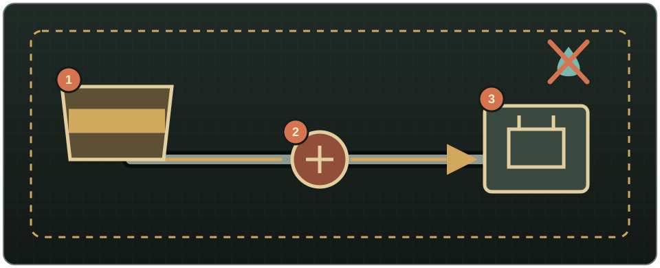

# Transporte de combustible

1. Usa un recipiente dedicado con **Gasolina** y coloca una tubería de suelo en su propia casilla.
2. Construye una ruta aislada hasta el generador. Añade una bomba con corriente si la altura, distancia o demanda dejan poca presión.
3. Coloca la última tubería en la misma casilla del generador.
4. Lleva una Llave para tubos, haz clic derecho en el generador y elige **Instalar Generador**.
5. Mantén la red exclusiva de gasolina. El generador la comprueba una vez por minuto de juego.

Cuando su depósito baja del umbral configurado (25 % por defecto), extrae hasta el objetivo (100 % por defecto). Un umbral de 0 desactiva el repostaje automático. Solo acepta una red de un único fluido Gasolina; una red vacía, mezclada o de agua no suministra nada.

{ .wp-diagram }

1. Depósito exclusivo de gasolina. 2. Bomba cuando se necesita presión. 3. Generador conectado. El perímetro discontinuo indica que la línea permanece separada del agua.

<!-- SCREENSHOT: 25-generator-connect-menu.png — Acción Instalar Generador con una tubería en su casilla. -->

Usa **Desinstalar Generador** para desconectarlo sin retirar la tubería.

!!! danger
    Nunca unas gasolina y agua potable. Usa un hueco físico, válvula cerrada o enrutador bien orientado y comprueba la superposición antes de abrir una frontera.
