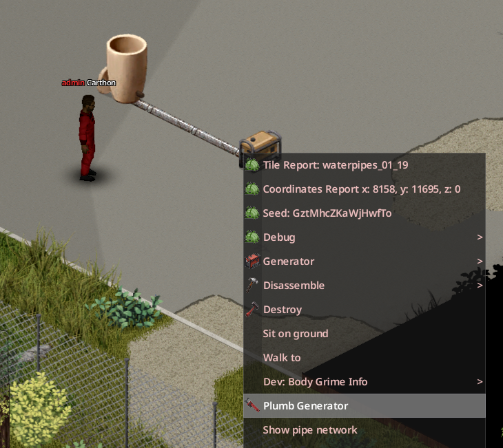

# Transporte de combustible

1. Usa un depósito solo para **Gasolina** y pon una tubería de suelo en su casilla.
2. Lleva las tuberías hasta el [generador](glossary.md#generador) por un recorrido que no toque ninguna red de agua. Si la altura, la distancia o el consumo dejan poca presión, añade una bomba con corriente.
3. Pon la última tubería en la misma casilla que el generador.
4. Con una Llave para tubos en el inventario, haz clic derecho en el generador y elige **Instalar Generador**.
5. Que en esa red solo haya gasolina. El generador la revisa una vez por minuto de juego.

Cuando su depósito de combustible baja del umbral configurado (25 % por defecto), el generador toma gasolina de la red hasta llegar al objetivo (100 % por defecto). Con el umbral a 0 no se rellena solo. Solo toma Gasolina: si la red está vacía o tiene agua, no recibe nada. Los líquidos incompatibles se rechazan; nunca se mezclan.

{ .wp-diagram }

- **1** Depósito solo para gasolina.
- **2** Bomba, si hace falta presión.
- **3** Generador conectado.

La línea discontinua indica que esta red no toca ninguna red de agua.

{ .wp-screenshot loading=lazy }

Para desconectarlo sin quitar la tubería, elige **Desinstalar Generador**.

!!! danger
    Mantén separadas las tuberías de gasolina y las de agua potable. Nunca se mezclan, pero una instalación compartida es más difícil de revisar y no hace que el generador pueda tomar agua ni que un grifo dé gasolina. Sepáralas con un hueco sin tubería, una válvula cerrada o un enrutador bien orientado.
