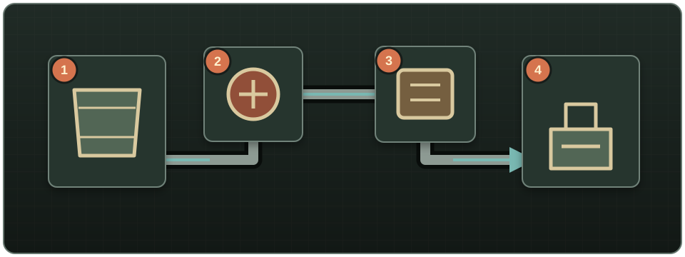

# Primeros pasos

Water Pipes es un mod para **Project Zomboid Build 42.15 o posterior**. Sus piezas se construyen desde **Menú de construcción → Fontanería**. Lleva una Llave para tubos utilizable en el inventario: hace falta para la mayoría de construcciones y conexiones, pero no se consume.

## Primera red para una base pequeña

Necesitas una Llave para tubos, una Tubería de metal o un Segmento de tubería de arcilla cocida por cada casilla, un recipiente de agua y un aparato compatible como un fregadero.

1. Coloca un barril, recolector de lluvia, ánfora u otro recipiente donde la red almacenará el agua.
2. Construye una **Tubería de fluidos** en la misma casilla del recipiente.
3. Extiende el trazado hasta el aparato. Las tuberías forman automáticamente rectas, esquinas, uniones y cruces.
4. Construye la última tubería en la misma casilla del aparato; una casilla adyacente no basta.
5. Con la Llave para tubos en el inventario, haz clic derecho en el aparato y elige **Fontanear**.
6. Haz clic derecho en cualquier tubería y elige **Mostrar red de tuberías**. Las tuberías aparecen rojas, las fuentes y depósitos verdes, los consumidores azules y los enrutadores regulados ámbar.
7. Prueba el aparato. Si la fuente está más baja o el recorrido es largo, añade una Bomba de agua con corriente y diagnostica la línea con un Manómetro.

{ .wp-diagram }

1. Depósito o fuente. 2. Bomba con corriente. 3. Control o punto de ramificación. 4. Consumidor. Las flechas indican el flujo previsto.

<!-- SCREENSHOT: 01-getting-started-materials.png — Llave, tuberías y recipiente preparados para la red inicial. -->
<!-- SCREENSHOT: 02-getting-started-small-network.png — Red inicial completa entre recipiente y fregadero, con la superposición visible. -->

!!! warning
    Una bomba aporta o mueve agua, pero no la almacena. Añade al menos un recipiente y nunca unas gasolina y agua en la misma red.

## Encuentra lo que necesitas

| Quiero… | Consulta… |
|---|---|
| Ver todas las recetas de construcción | [Redes de tuberías](pipe-networks.md), [Bombas y presión](pumps-and-pressure.md), [Enrutadores y válvulas](routers-and-valves.md), [Purificación](purification.md) y [Riego](irrigation.md) |
| Comparar todos los componentes construibles | [Catálogo de componentes](component-reference.md) |
| Seguir instalaciones completas de ejemplo | [Ejemplos prácticos](practical-examples.md) |
| Extraer de un pozo, río, red municipal o hidrante | [Fuentes y almacenamiento](sources-and-storage.md) |
| Conectar un fregadero, ducha, inodoro o lavadora | [Aparatos y fontanería](fixtures-and-plumbing.md) |
| Fontanear automáticamente una casa existente | [Fontanería de edificios](building-plumbing.md) |
| Transportar gasolina y repostar un generador | [Transporte de combustible](fuel-transport.md) |
| Cambiar la dificultad o los valores de simulación | [Opciones de sandbox](sandbox-settings.md) |
| Diagnosticar algo que no funciona | [Resolución de problemas](troubleshooting.md) y [Preguntas frecuentes](faq.md) |

## Siguientes pasos

- Aprende a colocar y desmontar en [Redes de tuberías](pipe-networks.md).
- Añade fuentes naturales y depósitos en [Fuentes y almacenamiento](sources-and-storage.md).
- Resuelve recorridos largos o cuesta arriba en [Bombas y presión](pumps-and-pressure.md).
- Conecta una casa completa en [Fontanería de edificios](building-plumbing.md).
