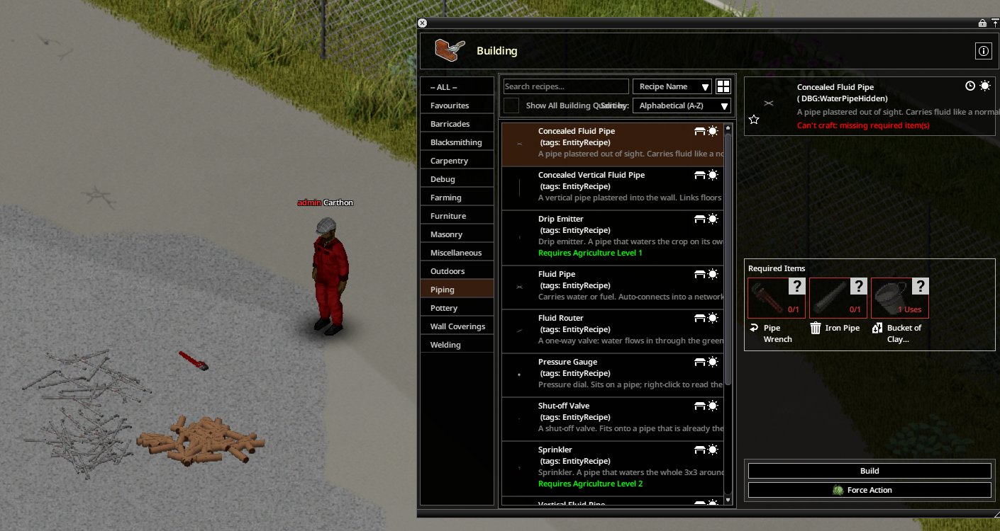
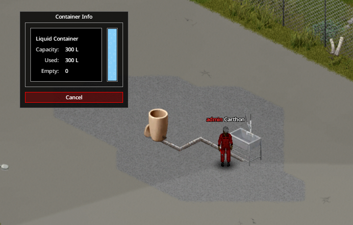
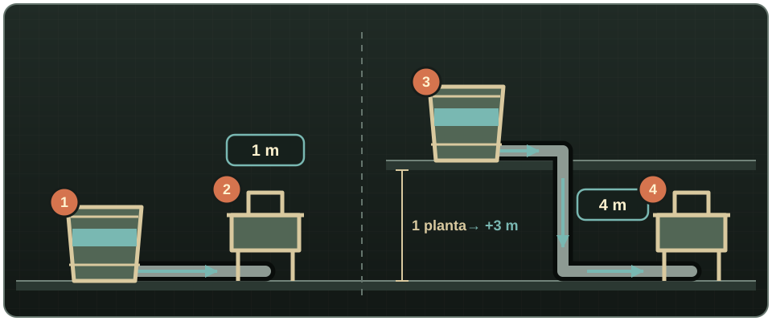
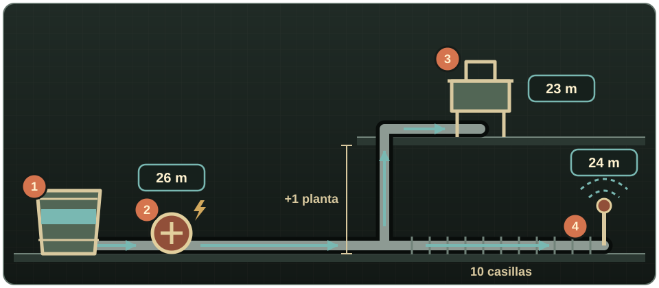

# Primeros pasos

Water Pipes es un [mod](glossary.md#mod) para **Project Zomboid Build 42.15 o posterior**. Todo lo que añade se construye desde el [menú de Construcción](glossary.md#menu-de-construccion), en la categoría **Fontanería**. Lleva siempre una Llave para tubos en el inventario: la piden casi todas las construcciones y conexiones, pero no se gasta.

Si no conoces el juego o algún término, consulta el [glosario](glossary.md).

## Tu primera red

Necesitas una Llave para tubos, un Tubo metálico o un Segmento de tubería de arcilla (ya cocido) por cada [casilla](glossary.md#casilla) de tubería, un [depósito](glossary.md#deposito) con agua y un [aparato](glossary.md#aparato) compatible, por ejemplo un fregadero.

1. Coloca un Barril recolector de lluvia, un Ánfora u otro depósito donde quieras guardar el agua. Los barriles que hay por el mapa solo guardan líquido con el mod [Useful Barrels](glossary.md#barril).
2. Construye una **Tubería de fluidos** en la misma casilla que el depósito.
3. Sigue poniendo tuberías hasta el aparato. Se unen solas formando rectas, esquinas, uniones en T y cruces.
4. Construye la última tubería en la misma casilla del aparato; en la casilla de al lado no sirve.
5. Con la Llave para tubos en el inventario, haz [clic derecho](glossary.md#clic-derecho) en el aparato y elige **[Instalar](glossary.md#instalar)** (el juego añade el nombre del objeto, por ejemplo «Instalar Fregadero»).
6. Haz clic derecho en cualquier tubería y elige **[Mostrar red de tuberías](glossary.md#mostrar-red)**. Las tuberías se ven en rojo, los depósitos y fuentes en verde, los aparatos en azul y los enrutadores con límite de presión en ámbar.
7. Prueba el aparato. Si no sale agua, comprueba que el depósito tiene agua y está en la misma planta que el aparato o más arriba. Si sigue sin funcionar, lee las instalaciones de abajo.

{ .wp-screenshot loading=lazy }

{ .wp-screenshot loading=lazy }

## Tres instalaciones para empezar

La altura se cuenta en [plantas](glossary.md#planta) y la distancia en casillas, pero la [presión](glossary.md#presion) se mide en metros (m), que es la unidad que usan los manómetros y las ventanas de bombas y enrutadores. Una regla fácil: **1 planta = 3 m**, así que los 25 m que da una bomba equivalen a subir el depósito unas 8 plantas. Las cifras están redondeadas al metro. Con los valores por defecto, un aparato recibe:

- **La presión que dan los depósitos.** Cada depósito con agua da 1 m en su propia planta, más 3 m por cada planta que esté por encima del aparato. No se suman entre sí: manda el que esté más alto.
- **Más 25 m por cada bomba encendida y con corriente** de la red. La bomba suma su presión a todos los depósitos de la red, y si pones varias bombas en la misma línea, sus presiones se suman.
- **Con el tope que marque un enrutador**, si hay uno por medio. Un enrutador puede bajar la presión, pero nunca subirla.

La distancia solo resta presión donde el riego hace correr agua por la tubería: unos 0,2 m por casilla por cada aspersor que haya más adelante en la línea, y unos 0,02 m por casilla por cada gotero. Los fregaderos, duchas, inodoros y demás aparatos no pierden nada por la distancia. Un aparato funciona con cualquier presión por encima de cero; un aspersor necesita 20 m y un gotero revienta si pasa de 15 m.

Para hacerte una idea: todos los depósitos dan el mismo 1 m, sean del tipo que sean, así que un barril o un ánfora en la misma planta que el fregadero lo alimenta a cualquier distancia. Con ese 1 m, un gotero solo llega a unas 45 casillas (1 m ÷ 0,022 m por casilla). Para los 20 m de un aspersor hacen falta unas 7 plantas de altura o una bomba.

### 1. Solo depósitos

{ .wp-diagram }

- **1** [Barril](glossary.md#barril) en la misma planta que **2**, un fregadero: 1 m de base = **1 m**. Poco, pero suficiente para un aparato.
- **3** Barril una planta más arriba, con la tubería bajando hasta **4**, un fregadero en la planta baja: 1 m + 1 planta × 3 m = **4 m**.

El propio depósito es el que da la presión, así que subirlo es la forma más barata de ganarla. Al revés no funciona: un fregadero una planta por encima de su único barril recibe 1 m − 1 planta × 3 m = −2 m, y no sale agua. Sube el barril o añade una bomba.

### 2. Depósito y bomba de agua

{ .wp-diagram }

- **1** Barril en la planta baja: 1 m.
- **2** [Bomba de agua](glossary.md#bomba) con corriente, a 2 casillas del barril: 1 m + 25 m = **26 m** para toda la red.
- **3** Fregadero una planta más arriba; su tubería vertical está a 6 casillas del barril. En esas 6 casillas, el agua que va al aspersor le quita 6 × 0,2 m, y la planta de altura otros 3 m, así que recibe **22 m**.
- **4** Aspersor a 10 casillas del barril: 26 m − 10 casillas × 0,2 m = **24 m**, por encima de los 20 m que necesita. Sin la bomba recibiría 1 m − 10 casillas × 0,2 m = −1 m y no regaría.

El barril sigue siendo imprescindible: la bomba empuja y mueve el agua, pero no guarda nada.

### 3. Bomba con una zona de goteros protegida por un enrutador

{ .wp-diagram }

- **1–2** Barril y bomba con corriente, como antes: **26 m**.
- **3** Fregadero en la línea principal: **26 m**.
- **4** [Enrutador de fluidos](glossary.md#enrutador) con la franja verde (entrada) hacia la bomba y la roja (salida) hacia los cultivos, y **Fijar límite de presión** en 12 m. El agua y la presión solo pasan de la entrada a la salida.
- **5** Goteros detrás del enrutador: **12 m**, por debajo de los 15 m que los revientan. Conectados directamente a la línea de la bomba recibirían 26 m y reventarían.

El enrutador no necesita corriente y nunca añade presión: con la bomba apagada, los goteros reciben el 1 m del barril. Tienes más detalles en [Enrutadores y válvulas](routers-and-valves.md) y [Riego](irrigation.md).

!!! warning
    Una bomba empuja o saca agua, pero no la guarda. Pon al menos un depósito en la red. Usa redes distintas para la gasolina y para el agua, aunque el mod nunca las mezcle: así es más fácil revisarlas.

## Encuentra lo que buscas

| Quiero… | Consulta… |
|---|---|
| Ver todas las recetas de construcción | [Redes de tuberías](pipe-networks.md), [Bombas y presión](pumps-and-pressure.md), [Enrutadores y válvulas](routers-and-valves.md), [Purificación](purification.md) y [Riego](irrigation.md) |
| Comparar todas las tuberías y todos los [componentes](glossary.md#componente) | [Catálogo de tuberías y componentes](component-reference.md) |
| Seguir instalaciones completas paso a paso | [Ejemplos prácticos](practical-examples.md) |
| Sacar agua de un pozo, un río, la red municipal o una boca de incendios | [Fuentes y almacenamiento](sources-and-storage.md) |
| Conectar un fregadero, una ducha, un inodoro o una lavadora | [Aparatos y fontanería](fixtures-and-plumbing.md) |
| Descubrir la fontanería oculta de una casa del mapa | [Inspeccionar fontanería](building-plumbing.md) |
| Llevar gasolina a un generador | [Transporte de combustible](fuel-transport.md) |
| Cambiar la dificultad o los valores de la simulación | [Opciones de sandbox](sandbox-settings.md) |
| Averiguar por qué algo no funciona | [Resolución de problemas](troubleshooting.md) y [Preguntas frecuentes](faq.md) |
| Entender un término | [Glosario](glossary.md) |

## Siguientes pasos

- Aprende a colocar y desmontar tuberías en [Redes de tuberías](pipe-networks.md).
- Añade pozos, ríos y más depósitos en [Fuentes y almacenamiento](sources-and-storage.md).
- Resuelve tramos largos o cuesta arriba en [Bombas y presión](pumps-and-pressure.md).
- Descubre la red que ya tiene un edificio del mapa en [Inspeccionar fontanería](building-plumbing.md). En lo que construyas tú, las tuberías se ponen a mano.
