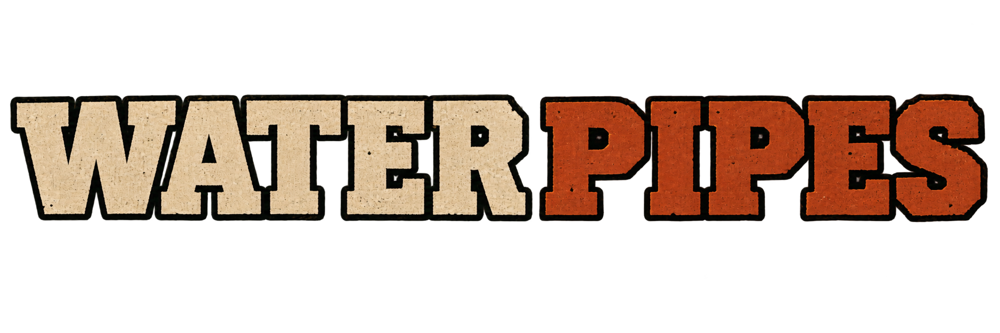

<section class="wp-hero" markdown>

Un mod para Project Zomboid — Build 42.15+

<h1 id="water-pipes">Water Pipes</h1>

Construye redes de tuberías que lleven agua, gasolina y otros líquidos compatibles a cualquier punto de tu base en Project Zomboid.

v0.11.x

[Primeros pasos](getting-started.md){ .md-button .md-button--primary }
[Qué incluye](core-concepts.md){ .md-button }

</section>

!!! note "Hecho para Project Zomboid"
    Water Pipes es un [mod](glossary.md#mod) no oficial para **[Project Zomboid](glossary.md#project-zomboid) [Build 42](glossary.md#build-42).15 o posterior**. Amplía lo que puedes construir en tu base: transporte y almacenamiento de líquidos, control de presión, purificación, riego y repostaje automático de generadores. ¿Es la primera vez que juegas? El [glosario](glossary.md) explica todos los términos.

## ¿Qué quieres hacer?

### :material-pipe-wrench: [Construir mi primera red](getting-started.md)

Lleva agua de un depósito a un fregadero con una instalación pequeña que funcione a la primera.

### :material-sprinkler-variant: [Automatizar el riego](practical-examples.md#instalar-riego)

Instala goteros o una zona de aspersores de 3×3 con la presión adecuada.

### :material-tools: [Arreglar una red](troubleshooting.md)

Averigua qué falla: conexiones, presión, bombas, purificadores o un líquido que no es el que toca.

## Una red, de la fuente al grifo

### :material-hammer-wrench: Construye

Tiende tuberías por el suelo, por las paredes o escondidas, o [descubre la fontanería oculta de un edificio del mapa](building-plumbing.md).

### :material-water: Abastece y almacena

Conecta recolectores de lluvia y otros depósitos, pozos, ríos, el agua municipal y bocas de incendios. Consulta [Fuentes y almacenamiento](sources-and-storage.md).

### :material-valve: Controla

Decide hacia dónde va el agua, corta tramos y ajusta la presión con bombas, enrutadores, válvulas y manómetros.

### :material-faucet: Aprovecha

Da agua a fregaderos y duchas, purifica el agua contaminada, riega cultivos o lleva gasolina a los generadores.

!!! info "Estado de la guía"
    La guía cubre todas las funciones de la serie v0.11.x, con instrucciones completas de montaje, uso y resolución de problemas. Las capturas del juego están en preparación.

## Enlaces del proyecto

- [Steam Workshop](https://steamcommunity.com/sharedfiles/filedetails/?id=3739595559)
- [Repositorio de GitHub](https://github.com/carthon/WaterPipesModPZ)
- [Informar de un error o sugerir una mejora](https://github.com/carthon/WaterPipesModPZ/issues)

[Ver en Steam Workshop](https://steamcommunity.com/sharedfiles/filedetails/?id=3739595559){ .md-button .md-button--primary }
[Preguntas frecuentes](faq.md){ .md-button .wp-button--secondary }
[Resolución de problemas](troubleshooting.md){ .md-button .wp-button--secondary }

