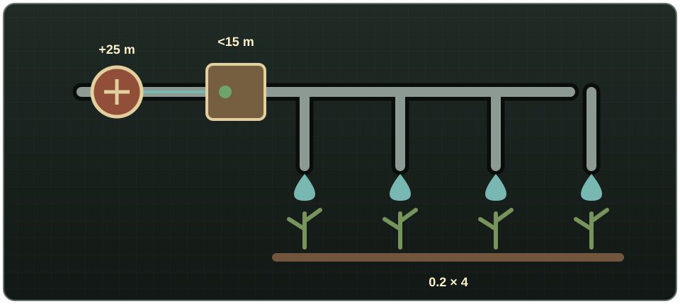
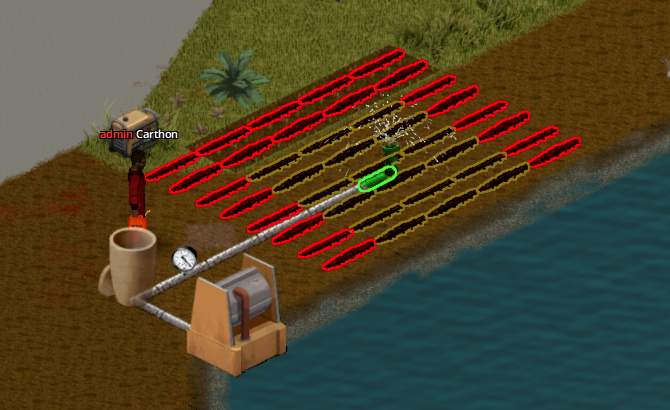
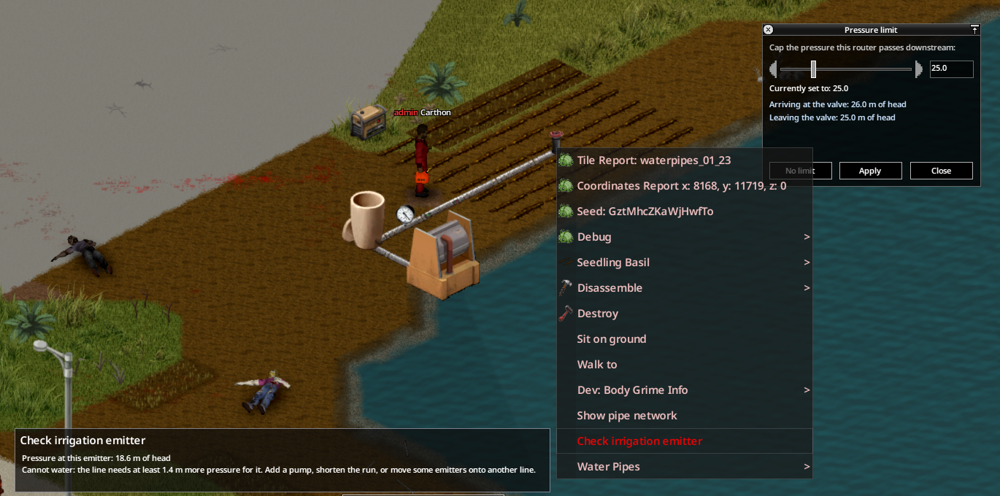

# Riego

| Componente | Receta | Qué riega | Presión por defecto | Agua que gasta |
|---|---|---|---:|---:|
| Gotero | Agricultura 1, Llave para tubos, 1 Tubo metálico | Su propia casilla | Sin mínimo; revienta por encima de 15 m | 0,2 L/hora |
| Aspersor | Agricultura 2, Llave para tubos, 1 Tubo metálico, 1 Chapa metálica | Un cuadrado de 3×3 casillas | Necesita 20 m | 1,8 L/hora |

Construir un gotero da 10 XP de Agricultura, y un aspersor, 20. Los dos funcionan también como tubería: dejan pasar el agua hacia las siguientes y se pueden poner encima de los cultivos. Mientras una planta viva necesite agua, le suman 10 puntos de riego por cada hora de juego. El [agua contaminada](glossary.md#agua-contaminada) riega igual de bien que la limpia.

El gotero solo gasta agua en su casilla. El aspersor gasta agua por las nueve casillas, haya cultivos o no, y, si está activado en las opciones de sandbox, hace ruido que se oye a 12 casillas (y atrae zombis). Su chorro también moja a los personajes que estén dentro del cuadrado.

## Instalaciones seguras

- **Línea de goteros:** fuente o bomba → enrutador con un límite por debajo de la presión que revienta los goteros → fila de goteros.
- **Zona de aspersores:** fuente → bomba o red municipal → enrutador → ramal corto de aspersores. Divide las granjas grandes en varias zonas: si todos los aspersores comparten la misma línea, los del final se quedan sin presión (es la [demanda compartida](glossary.md#demanda-compartida)).
- Haz clic derecho en un gotero o aspersor y elige **Comprobar emisor de riego** para saber si no tiene agua, si le falta presión, si está a punto de reventar o si ya ha reventado.
- **Riego automático:** una Válvula de corte delante de la zona, vinculada a un [Sensor de humedad](#sensor-de-humedad) entre los cultivos, solo se abre cuando están secos.

{ .wp-diagram }

- **1–2** Barril y bomba con corriente: 1 m + 25 m = **26 m**.
- **3** Enrutador con **Fijar límite de presión** en 12 m, por debajo de los 15 m que revientan un gotero.
- **4** Cuatro goteros de 0,2 L/hora en casillas seguidas: **12 m**. Entre los cuatro pierden menos de 0,1 m por casilla.

Un gotero reventado sigue dejando pasar el agua, pero deja de regar. Se repara con **Reparar gotero**, una Llave para tubos y 1 Cinta americana. Si pones la presión de rotura a 0 en las opciones de sandbox, los goteros no revientan nunca.

{ .wp-screenshot loading=lazy }
{ .wp-screenshot loading=lazy }

## Sensor de humedad { #sensor-de-humedad }

Una estaca que se clava en la tierra junto a un cultivo. Mide cuánta agua tiene el cultivo de su casilla, el mismo valor de 0 a 100 % que usa la agricultura del juego, y abre o cierra las [Válvulas de corte](routers-and-valves.md#valvula-de-corte) que le vincules. Pon una válvula delante de una fila de goteros o de una zona de aspersores y los cultivos se regarán solos, solo cuando lo necesiten.

| Receta | Habilidad | Herramientas |
|---|---|---|
| 1 Sensor de movimiento, 1 Receptor, 1 Cable Eléctrico, 2 Chatarra electrónica | Electrónica 3 (da 20 XP de Electrónica) | Destornillador, no se gasta |

### Dónde se coloca

- Solo en tierra que se pueda cultivar (tierra o hierba), o en una casilla que ya tenga un surco o un cultivo. Un sensor por casilla.
- Pulsa **R** mientras lo colocas para elegir en qué esquina de la casilla va la estaca.
- Comparte casilla con tuberías, goteros, aspersores, válvulas y manómetros, y nunca corta el gotero o el aspersor de su casilla: solo mide.

### Cómo decide

- Cuando la humedad del cultivo **baja hasta el mínimo**, da señal; cuando **sube hasta el máximo**, la quita. Entre los dos sigue como estaba, así la válvula no se abre y se cierra sin parar alrededor de un mismo valor. Por defecto son **80 %** y **95 %**.
- **Invertir** cambia los extremos: señal en el máximo y sin señal en el mínimo.
- Si no hay cultivo en su casilla o no tiene energía, no da señal.
- Comprueba cada 10 minutos de juego. Mientras no hay nadie cerca, mantiene su última señal hasta que vuelve un jugador.
- Su luz indica el estado: **verde** = da señal, **roja** = no da señal, **apagada** = sin energía.

### Energía

Funciona con la electricidad de la casilla (la red o un generador). Si no hay, usa una Pila: clic derecho en el sensor, **Abrir sensor**, y arrastra la pila a la ranura de la pila (o haz clic en la ranura para poner la más cargada que lleves), como en una radio. Por defecto una pila llena dura 30 días de juego (consulta las [opciones de sandbox](sandbox-settings.md#riego-y-agua-municipal)) y solo se gasta mientras la casilla no tiene electricidad. Clic derecho en la ranura te la devuelve con la carga que le quede.

### Vincular válvulas

1. Haz clic derecho en el sensor y elige **Abrir sensor**. La ventana muestra la lectura, la señal y su motivo, la energía, el rango y las válvulas vinculadas.
2. Ajusta **Mínimo** y **Máximo** (e **Invertir** si lo necesitas) y pulsa **Aplicar**.
3. Pulsa **Vincular válvulas**. Las válvulas que tienes alrededor se marcan: **verde** se puede vincular, **amarilla** ya está vinculada (haz clic para desvincularla), **roja** no se puede vincular. La primera vez que vinculas una válvula le pones un nombre, que luego aparece en las listas y en la información de la válvula.
4. Pulsa **Esc** o haz clic derecho para terminar.

Una válvula vinculada **se abre mientras alguno de sus sensores da señal** y se cierra cuando ninguno la da. Un sensor puede controlar varias válvulas, y varios sensores, una misma válvula. Tu mano sigue mandando: **Cerrar válvula** la deja cerrada digan lo que digan los sensores, y **Abrir válvula** les devuelve el control. La información de la válvula dice qué sensores la controlan y por qué está cerrada.

En multijugador, una válvula dentro de un refugio solo la pueden vincular sus miembros o un administrador. Las opciones de sandbox pueden limitar a qué distancia del sensor puede estar la válvula (por defecto, sin límite).

### Moverlo y quitarlo

- **Recoger** lo mueve: se lleva su nombre, su rango y si está invertido; la pila va a tu inventario y los vínculos se pierden.
- **Desmontar** con un Destornillador devuelve la pila y parte de las piezas (casi siempre el Sensor de movimiento, el Receptor y el Cable Eléctrico; la Chatarra electrónica, menos a menudo). Si se destruye, solo devuelve la pila.

<!-- SCREENSHOT: 27-moisture-sensor.png — Sensor de humedad en una fila de cultivos y su ventana con válvulas vinculadas. -->
