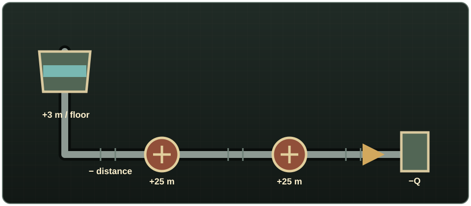

# Bombas y presión

## Construir una bomba

Una **Bomba de agua** exige Electricidad 3, Soldadura 2, Llave para tubos, 2 usos de Soplete, 1 uso de Varilla de soldadura, 2 Tuberías de metal, 4 Chapas metálicas, 2 Restos electrónicos y 1 Cable. Construirla concede 30 XP de Electricidad y 20 XP de Soldadura. Gírala antes de colocarla para elegir eje norte-sur o este-oeste.

Necesita corriente y tener encendido su interruptor manual. En una línea con suministro actúa como grupo de presión; junto a un pozo o agua abierta también introduce agua en la red. Colócala abajo: la aspiración predeterminada alcanza 7 m (unas dos plantas), mientras que añade 25 m de presión de salida. Las bombas alimentadas en serie suman su presión.

<!-- SCREENSHOT: 08-pump-source-placement.png — Colocación correcta de una bomba junto a un pozo o casilla de agua abierta. -->
<!-- SCREENSHOT: 09-pump-status-window.png — Ventana Comprobar bomba con energía, fuente y presión de entrada/salida. -->

## Cómo se calcula la presión

La presión se mide en metros de columna de agua. En el modelo **Realista** predeterminado:

- un recipiente parte de 1 m de presión;
- cada planta que la fuente esté por encima del consumidor añade 3 m;
- la distancia consume presión según el caudal y la demanda compartida aguas abajo;
- cada bomba con corriente añade 25 m;
- los enrutadores pueden limitar, pero nunca aumentar, la presión de salida.

El modelo **Simple** cuenta la altura, pero ignora la pérdida por distancia. **Desactivado** restaura el alcance solo por gravedad. Una transferencia con presión baja todavía puede funcionar más despacio hasta dejar de cumplir el mínimo del consumidor.

{ .wp-diagram }

La fuente elevada aporta +3 m por planta, cada bomba con corriente suma +25 m, el recorrido pierde presión y la demanda compartida (`Q`) aumenta esa pérdida.

## Diagnóstico

Usa **Comprobar bomba** para distinguir apagado manual, falta de corriente, ausencia de fuente y funcionamiento solo como impulsor. Construye un **Manómetro** sobre una tubería simple existente con 1 Tubería de metal y 1 Resto electrónico; haz clic derecho para leer el valor local y saber si funcionaría un aspersor.

Si una rama no recibe suficiente, acórtala, reduce consumidores simultáneos, divide la instalación en zonas mediante enrutadores, eleva la fuente o añade una bomba con corriente. Revisa [Opciones de sandbox](sandbox-settings.md), porque todos estos valores son configurables.
