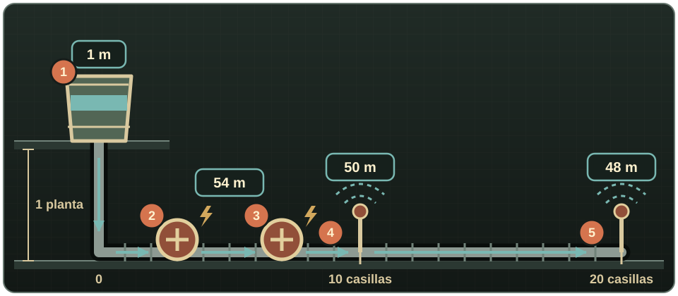

# Bombas y presión

## Construir una bomba

Una **Bomba de agua** exige Electricidad 3, Soldadura 2, Llave para tubos, 2 usos de Soplete, 1 uso de Varilla de soldadura, 2 Tuberías de metal, 4 Chapas metálicas, 2 Restos electrónicos y 1 Cable. Construirla concede 30 XP de Electricidad y 20 XP de Soldadura. Gírala antes de colocarla para elegir eje norte-sur o este-oeste.

Necesita corriente y tener encendido su interruptor manual. En una línea con suministro actúa como grupo de presión; junto a un pozo o agua abierta también introduce agua en la red. Colócala abajo: la aspiración predeterminada alcanza 7 m (unas dos plantas), mientras que añade 25 m de presión de salida. Las bombas alimentadas en serie suman su presión.

{ .wp-screenshot loading=lazy }
{ .wp-screenshot loading=lazy }

## Cómo se calcula la presión

La presión se mide en metros de columna de agua. En el modelo **Realista** predeterminado:

- un recipiente parte de 1 m de presión;
- cada planta que la fuente esté por encima del consumidor añade 3 m;
- la distancia consume presión según el caudal y la demanda compartida aguas abajo;
- cada bomba con corriente añade 25 m;
- los enrutadores pueden limitar, pero nunca aumentar, la presión de salida.

El modelo **Simple** cuenta la altura, pero ignora la pérdida por distancia. **Desactivado** restaura el alcance solo por gravedad. Una transferencia con presión baja todavía puede funcionar más despacio hasta dejar de cumplir el mínimo del consumidor.

{ .wp-diagram }

- **1** Barril una planta por encima de la línea: 1 m + 1 planta × 3 m = 4 m.
- **2–3** Dos bombas con corriente. Cada una suma 25 m a toda la red, esté donde esté: 4 m + 2 × 25 m = **54 m**.
- **4** Aspersor a 10 casillas. Por ese tramo pasa el caudal de los dos aspersores: 54 m − 10 casillas × 2 × 0,2 m = **50 m**.
- **5** Aspersor a 20 casillas. De la casilla 10 a la 20 solo pasa su propio caudal: 50 m − 10 casillas × 0,2 m = **48 m**.

La demanda compartida es lo que encarece la distancia: cada consumidor de riego aguas abajo suma su caudal a la pérdida de cada casilla que comparte.

## Diagnóstico

Usa **Comprobar bomba** para distinguir apagado manual, falta de corriente, ausencia de fuente y funcionamiento solo como impulsor. Construye un **Manómetro** sobre una tubería simple existente con 1 Tubería de metal y 1 Resto electrónico; haz clic derecho para leer el valor local y saber si funcionaría un aspersor.

Si una rama no recibe suficiente, acórtala, reduce consumidores simultáneos, divide la instalación en zonas mediante enrutadores, eleva la fuente o añade una bomba con corriente. Revisa [Opciones de sandbox](sandbox-settings.md), porque todos estos valores son configurables.
