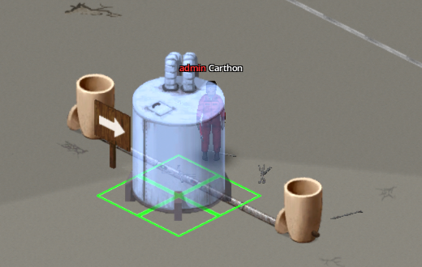
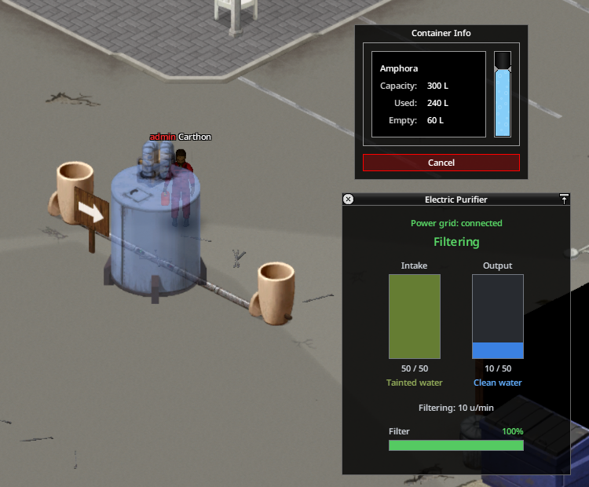

# Purificación

## Construcción

El **Purificador de agua (eléctrico)** exige Electricidad 4, Soldadura 3, Llave para tubos, 3 usos de Soplete, 2 usos de Varilla de soldadura, 3 Tuberías de metal, 2 Chapas metálicas, 1 Resto electrónico, 1 Cable, 1 Batería de encendedor, 1 objeto de carbón y 2 Trozos de tela. Construirlo concede 40 XP de Electricidad y 30 XP de Soldadura.

Construye y orienta primero un Enrutador de fluidos: verde es la **entrada** de agua contaminada y rojo la **salida** limpia. El purificador ocupa 2×2 casillas; coloca su esquina superior/trasera sobre la casilla del enrutador y deja libre el suelo de la planta superior sobre ese anclaje. No se puede colocar sin enrutador ni sobre otro purificador.

{ .wp-diagram }

- **1** Depósito contaminado.
- **2** Entrada verde del enrutador.
- **3** Purificador con corriente y filtro, colocado sobre el enrutador.
- **4** Salida roja del enrutador.
- **5** Depósito limpio.

{ .wp-screenshot loading=lazy }

## Funcionamiento y filtro

Con corriente, aspira hasta 20 unidades/min y convierte hasta 10 unidades/min. Sus depósitos internos de entrada y salida guardan 50 unidades cada uno. No procesa agua limpia ni líquidos incompatibles que no sean agua. El almacenamiento externo del lado limpio es opcional, pero recomendable: sin él, el proceso se detiene cuando se llena el búfer de salida de 50 unidades.

El filtro empieza al 100 %. Con el desgaste predeterminado limpia unas 5000 unidades antes de atascarse. Usa **Reparar filtro** con 1 objeto de carbón y 2 Trozos de tela; vuelve al 100 %. **Abrir purificador** muestra corriente, entrada, salida, ritmo y estado del filtro. El sonido ambiente puede desactivarse en **Opciones → Mods → Water Pipes**.

Por defecto el lado limpio recibe el 60 % de la presión entrante: 25 m se convierten en 15 m, suficiente para grifos y goteo, pero menos de los 20 m de un aspersor. Añade una bomba después del purificador o cambia el porcentaje de sandbox cuando sea necesario.

## Desmontaje

Usa un Soplete con combustible y Máscara de soldar. Cada devolución se calcula por separado: 1 Chapa metálica y 2 Tuberías de metal al 80 %, más 1 Resto electrónico y 1 Cable al 60 %. No recuperas batería, carbón ni telas; destruirlo no devuelve nada.

{ .wp-screenshot loading=lazy }
